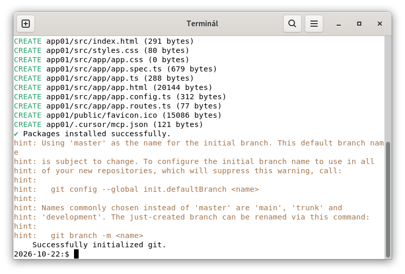

# Kezdés

## Tartalomjegyzék

* [Tartalomjegyzék](#tartalomjegyzék)
* [Feltételezett ismeretek](#feltételezett-ismeretek)
* [Angular ellenőrzése](#angular-ellenőrzése)
* [Projekt készítése](#projekt-készítése)
* [Könyvtárszerkezet](#könyvtárszerkezet)
* [Adatkötés](#adatkötés)
* [Vezérlési szerkezetek](#vezérlési-szerkezetek)
* [Signal](#signal)
* [Bootstrap](#bootstrap)

## Feltételezett ismeretek

* HTML
* CSS
* JavaScript
* Minimális Node.js (node, npm parancsok)

## Angular ellenőrzése

Használjunk Command Promptot (cmd). PowerShellben
engedélyezni szükséges a parancsot.

```bash
ng version
```

_röviden_:

```bash
ng v
```

## Projekt készítése

```bash
ng new app01
```

```bash
ng new app01
? Which stylesheet system would you like to use?
❯ CSS             [ https://developer.mozilla.org/docs/Web/CSS                  
   ]
  Tailwind CSS    [ https://tailwindcss.com
   ]
  Sass (SCSS)     [ https://sass-lang.com/documentation/syntax#scss
   ]
  Sass (Indented) [ https://sass-lang.com/documentation/syntax#the-indented-synt

↑↓ navigate • ⏎ select
```

```bash
✔ Which stylesheet system would you like to use? CSS             [ https://devel
oper.mozilla.org/docs/Web/CSS                     ]
? Do you want to enable Server-Side Rendering (SSR) and Static Site Generation (
SSG/Prerendering)? (y/N)

```

```bash
ng new app01
✔ Which stylesheet system would you like to use? CSS             [ https://devel
oper.mozilla.org/docs/Web/CSS                     ]
✔ Do you want to enable Server-Side Rendering (SSR) and Static Site Generation (
SSG/Prerendering)? No
? Which AI tools should Angular integrate with? https://angular.dev/ai/develop-w
ith-ai
 ◯ None
 ◯ Claude Code   [ `CLAUDE.md` + Angular MCP server config ]
❯◉ Cursor        [ `AGENTS.md` + Angular MCP server config ]
 ◯ Gemini CLI    [ `GEMINI.md` + Angular MCP server config ]
 ◯ Open AI Codex [ `AGENTS.md` + Angular MCP server config ]
 ◯ VSCode        [ `AGENTS.md` + Angular MCP server config ]

↑↓ navigate • space select • a all • i invert • ⏎ submit
```



## Könyvtárszerkezet

```txt
app01/
  |-.cursor/
  |-.vscode/
  |-node_modules/
  |-public/
  |-src/
  |  |-app/
  |  |  |-app.config.ts
  |  |  |-app.css
  |  |  |-app.html
  |  |  |-app.routes.ts
  |  |  |-app.spec.ts
  |  |  `-app.ts
  |  |-index.html
  |  |-maint.ts
  |  `-styles.css
  |-.editorconfig
  |-.gitignore
  |-.prettierc
  |-AGENTS.md
  |-angular.json
  |-package-lock.json
  |-package.json
  |-README.md
  |-tsconfig.app.json
  |-tsconfig.json
  `-tsconfig.spec.json
```

* _.cursor/_: A Cursor LLM-t (AI) segítő szabályzat.
* _.vscode/_: VSCode kódszerkesztő beállításai.
* _node_modules/_: Projekthez letöltött csomagok helye.
* _public/_: Statikus fájlok helye (képek, ikonok stb.).
* _src/_: Az alkalmazás forráskódja.

Az src/ mappa tartalma:

* _src/app/app.config.ts_: Az alkalmazás globális konfiguráicós állománya.
* _src/app/app.css_: A főkomponens stílusbeállításai.
* _src/app/app.routes.ts_: Útválasztások helye.
* _src/app/app.spec.ts_: A főkomponens egységtesztje.
* _src/app/app.ts_: A főkomponens TypeScript vezérlőfájlja.

Egyéb fájlok az src/ mappában:

* _index.html_: Az alkalmazás fő HTML állománya.
* _main.ts_: Az alkalmazás fő belépési pontja.
* _style.css_: Globális stíluslap.

A projekt gyökérkönyvtára:

* _.editorconfig_: Segíti a konzisztens kódformázás a különböző kódszerkesztök között. Például behúzások, szóközök.
* _.gitignore_: Milyen fájlokat, mappákat ne mentesen.
* _.prettierc_: A Prettier kódfomárzó eszköz beállítsai.
* _AGENTS.md_: Egyéni dokumentáció az LLM (AI) számára.
* _angular.json_: Az Angular CLI fő konfigurációs állománya.
* _package-lock.json_: Az npm csomagok pontos verzió és függőségeinek leírása.
* _package.json_: Node.js projektleíró állomány.
* _README.md_: A projekt leírása, bemutatása.
* _tsconfig.app.json_: TypeScript konfigurációs fájl az src számára.
* _tsconfig.json_: Globális TypeScript fordítóbeállítások.
* _tsconfig.spec.json_: TypeScript konfiguráció tesztek futtatásához.

## Adatkötés

A főkomponensben fogunk dolgozni. A főkomponens állományai:

* app.css
* app.html
* app.spec.ts
* app.ts

### Típusok

A TypeScript egy típusos nyelv. A típust a változó neve után adjuk meg.

```typescript
nev: string = 'Erős István'
telepules: string = "Szeged"
```

```typescript
fizetes: number = 395
vanKocsija: boolean = true
```

A típsok elhagyhatók, ha azonnal értéket adunk:

```typescript
nev = 'Erős István'
telepules = "Szeged"
```

```typescript
fizetes = 395
vanKocsija = true
```

A típus kötelező ha nem adunk azonnal értéket:

```typescript
nev: string;
telepules: string;
ngOnInit() {
    this.nev =  'Erős István'
    this.telepules = "Szeged"
}
```

Az ngOnInit() egy speciális metódus, mivel automatikusan végrehajtódik, amikor az adott komponens betöltődik. Minden komponensben használható.

Erre a célra a konstruktor is használható lenne, de ez nem javasolt, mivel a komponens ekkor még nem töltődött be.

Az ngOnInit egy életciklus (Lifecycle) kezelő metódus,
amit használatunk egy komponens előkészítésére.

### Interpoláció

Adat kötése TypeScript fájlból HTML sablonba.

Az _app.ts_ fájlban vegyük fel egy változót az App osztályon belül:

```typescript
export class App {
    nev: string = 'Erős István'
}
```

Kössük a HTML sablonba:

_app.html_:

```html5
<h1>Első projektem</h1>

<p>{{ nev }}</p>
```

### Property binding

```typescript
export class App {
    kepUrl = 'https://szit.hu/download/peldak/css/kopasz-hegy.jpg'
}
```

Kössük a HTML sablonba:

_app.html_:

```html5
<h1>Első projektem</h1>


```

### Event binding

Események kötése.

```typescript
export class App {
    valami() {
        console.log('működik...')
    }
}
```

Kössük a HTML sablonba:

_app.html_:

```html5
<h1>Első projektem</h1>

<button (click)="valami()">Mehet</button>
```

## Vezérlési szerkezetek

### @if használata

```typescript
visibleDiv = false
```

```html
@if(visibleDiv) {
    <div>Egy</div>
}
```

Írjunk egy függvényt, ami mindig az ellentétjére váltja a visibleDiv tartalmát:

```typescript
toggleVisible() {
    this.visibleDiv = ! this.visibleDiv
}
```

### @for használata

Vegyünk fel egy listát TypeScript oldalon:

```typescript
fruitList = ['alma', 'körte', 'barack', 'szilva']
```

Rendereljük a HTML sablonban:

```html
<ul>
    @for(fruit of fruitList; track fruit) {
        <li>{{fruit}}</li>
    }
</ul>
```

## Signal

A signal() körbeölel egy értéket, és azonnal értesíti a függőségeit, ha az érték megváltozik.

```typescript
num = signal(0)
```

Kössük a HTML sablonba:

```html
<p>{{num()}}</p>
```

A num egy függvény, ezért szükséges a zárójelpáros.

## Bootstrap

Adjuk hozzá a projektünkhöz Bootstrap-t:

```bash
npm install bootstrap
```

Ha Bootstrap ikonokat is szeretnék hozzáadni:

```bash
npm install bootstrap-icons
```
